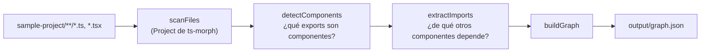

# DevTree

Herramienta para analizar un proyecto React/TypeScript y generar un grafo
de sus componentes y las dependencias entre ellos (quién importa a quién),
como insumo para visualizarlo más adelante (React Flow) y, sobre esa base,
habilitar generación de código asistida.

## Stack técnico

- Node.js + TypeScript
- [`ts-morph`](https://github.com/dsherret/ts-morph) para el análisis de
  AST (el parser no usa regex para resolver imports/exports, se apoya en
  el compilador de TypeScript)
- [Vitest](https://vitest.dev/) para tests
- ESLint (flat config, `typescript-eslint`) + Prettier, corridos vía
  Husky + lint-staged en cada commit

## Arquitectura

El parser (`poc-parser/src/index.ts`) encadena cuatro pasos, cada uno en
su propio módulo (ver `PLAN.md` Pasos 1-4):



`detectComponents` reconoce cuatro formas de exportar un componente
(function declaration, arrow const, default export anónimo, componente
envuelto en un HOC); `extractImports` resuelve la dependencia real de
cada uno, siguiendo imports estáticos, barrels/re-exports y
`React.lazy(() => import(...))` vía el compilador de TypeScript (no
regex). Ver `PLAN.md` para el detalle de cada caso.

## Estructura del repo

```
poc-parser/         # el parser en si (Node/TS CLI)
sample-project/      # proyecto React/TS de juguete usado como fixture
                      # para probar el parser
```

## Instalación y uso

Requiere Node.js y [pnpm](https://pnpm.io/) instalados. No hay variables
de entorno. Usar siempre `pnpm`, no `npm`.

```bash
# Herramientas de repo (lint/format/hooks), en la raíz
pnpm install

# El parser
cd poc-parser
pnpm install
pnpm test          # corre la suite de tests (vitest)
pnpm run build      # compila TypeScript
pnpm run scan       # corre el parser contra sample-project/ y escribe
                     # poc-parser/output/graph.json
```

## Estado actual

POC en desarrollo. El parser (`poc-parser/`) cubre: detección de
componentes (function declarations, arrow consts, default exports
anónimos, componentes envueltos en HOCs), resolución de sus dependencias
locales (imports estáticos, barrels/re-exports, `React.lazy`), y
construcción del grafo final. Ver `PLAN.md` para el detalle paso a paso
y los casos límite conocidos, y `PROGRESS.txt` para el historial de
sesiones de trabajo.

Todavía no incluye: generación de código con LLM, drag and drop, backend,
ni UI de visualización.

## Licencia

[MIT](LICENSE)
